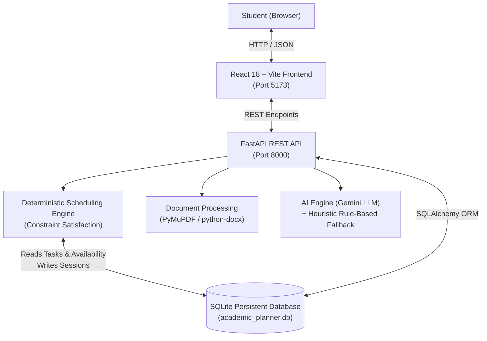

# AI-Based Personalized Academic Workload Optimizer

A full-stack, AI-powered academic planning web application built for college engineering students. The system parses assignment sheets (PDF/DOCX), breaks assignments into sequential subtasks, calibrates completion speed based on student history, generates constraint-satisfaction daily study timetables, and features an interactive doubt-solving academic assistant.

---

## 1. Problem Statement & Motivation

Engineering and computer science students frequently handle multiple parallel coursework deadlines—including practical lab records, mini-projects, term papers, and semester examinations. 

Key challenges include:
* **Inaccurate Time Estimation:** Students struggle to gauge how long practical coding or research actually takes.
* **Rigid Planning:** When an assignment task is delayed, conventional static calendar entries become obsolete.
* **Cognitive Overload:** Students lack early warning when assigned work physically exceeds their remaining daily study hours before upcoming deadlines.

**Solution:** An intelligent academic workload planner that combines deterministic constraint-satisfaction scheduling with an AI/heuristic decomposition engine and persistent SQLite storage.

---

## 2. Architecture & System Design



---

## 3. Technology Stack

* **Frontend:** React 18, Vite, JavaScript (ES6+), HTML5, Modern Academic CSS Design System, Lucide React icons, Recharts data visualization.
* **Backend:** Python 3.13, FastAPI, Uvicorn (ASGI server), Pydantic v2 data validation.
* **Database & Persistence:** SQLite with SQLAlchemy ORM (Single-user local persistence).
* **Document Processing:** PyMuPDF (`fitz`) for PDF text parsing and `python-docx` for Word documents.
* **AI & Fallback:** Google Gemini API integration via backend environment (`LLM_API_KEY`) with transparent, offline rule-based academic knowledge fallback.
* **Testing:** Pytest automated test suite with SQLite in-memory test isolation.

---

## 4. Key Functional Features

1. **Dashboard & KPIs:** Displays active assignments, pending/completed tasks, today's study load in hours, upcoming deadlines, and diagnostic overload alerts.
2. **Assignment Management (CRUD):** Create, view, filter, edit, and delete academic assignments with validation on titles, subjects, priorities, difficulties, and explicit deadline confirmation.
3. **Document Upload & Extraction:** Uploads `.pdf` or `.docx` files privately into `uploads/`, extracts text, identifies possible titles, course codes, deadlines, and deliverables, and renders an editable confirmation form before saving.
4. **Task Decomposition Engine:** Splits assignments into sequential milestones (Requirements, Literature Research, Core Implementation, Documentation & Screenshots, Final Review). Works with live LLMs or intelligent rule-based fallback.
5. **Personalized Scheduling Engine (`scheduling_engine.py`):**
   * Computes task urgency weights based on deadlines, priorities, and difficulties.
   * Strictly respects student availability hours configured per day of the week (e.g. Mon–Sun).
   * Enforces topological task prerequisites (dependencies).
   * Allocates 45–60 minute focus blocks interspersed with 10-minute restorative breaks.
   * Detects and warns on workload overload and missed deadline risks.
6. **Adaptive Rescheduling:** Shifts incomplete tasks forward, preserves past completed work, and recalculates future sessions.
7. **Personal Work-Speed Calibration:** Records estimated versus actual logged time. Applies a weighted historical factor per category (`Coding`, `Research`, `Report writing`, `Revision`) to calibrate future estimates without false ML claims.
8. **Reminders & Alerts:** Persistent SQLite reminders for 24h/48h deadlines, overdue items, and daily study sessions, with optional Browser Notification API integration.
9. **Academic Doubt Assistant:** Step-by-step conceptual explanations and debugging methodologies for computer science coursework.

---

## 5. Database Schema (SQLite)

* `assignments`: Stores title, subject, description, instructions, deadline, priority, difficulty, estimated hours, and status.
* `tasks`: Stores subtasks linked to assignments with order index, category, estimated vs actual hours, dependencies, and completion status.
* `daily_availability`: Stores student availability per day of week (0=Mon to 6=Sun) with daily capacity and start/end time windows.
* `scheduled_sessions`: Stores concrete timetable blocks with date, start time, end time, duration, session type (Study/Break), and manual adjustment flags.
* `reminders`: Stores in-app and browser notification triggers with read/dismissed states.
* `work_history`: Stores completed task speed ratios (`actual / estimated`) used by the calibration formula.
* `planning_events`: Audit log of schedule calculations and adaptive rescheduling triggers.

---

## 6. Windows Step-by-Step Installation & Running Guide

Open Windows PowerShell in the project directory (`ai`):

### Step 1: Create & Activate Python Virtual Environment
```powershell
# Create virtual environment
python -m venv venv

# If PowerShell script execution is restricted on your machine, activate using either:
.\venv\Scripts\activate.bat
# Or run python/uvicorn directly via:
.\venv\Scripts\python.exe
```

### Step 2: Install Backend Dependencies
```powershell
.\venv\Scripts\pip.exe install -r backend\requirements.txt
```

### Step 3: Install Frontend Dependencies
```powershell
cd frontend
npm.cmd install
cd ..
```

### Step 4: Start the FastAPI Backend Server
In Terminal 1:
```powershell
$env:PYTHONPATH="backend"
.\venv\Scripts\uvicorn.exe app.main:app --host 127.0.0.1 --port 8000 --reload
```
* Backend will be live at: **http://127.0.0.1:8000**
* Interactive Swagger API Docs: **http://127.0.0.1:8000/docs**
* Health Check: **http://127.0.0.1:8000/health**

### Step 5: Start the React Frontend Server
Open a second PowerShell terminal in the same folder and run:
```powershell
cd frontend
npm.cmd run dev
```
* Frontend will be live at: **http://localhost:5173**

---

## 7. Running Automated Tests

Run the backend test suite:
```powershell
$env:PYTHONPATH="backend"
.\venv\Scripts\pytest.exe backend\tests -v
```

All 10 test suites verify:
1. Backend health status
2. Assignment CRUD and SQLite persistence
3. Invalid inputs and deadline validations
4. Document upload restrictions (rejects empty or unsupported files)
5. Rule-based fallback when no external AI API key is configured
6. Work-speed calibration with empty history baseline
7. Schedule generation without overlapping study sessions
8. Workload overload detection when availability is insufficient
9. Overdue deadline detection and warning generation
10. Adaptive rescheduling preserving completed work

---

## 8. College Project Review Demonstration Walkthrough

1. **Dashboard:** Open `http://localhost:5173`. Click the **"Demo Data"** button in the top navbar. This immediately seeds 3 realistic CSE assignments (Operating Systems, Database Systems, Web Engineering) and generates an initial schedule.
2. **Assignments:** Navigate to **Assignments** to demonstrate creating a new assignment, editing priority, or deleting. Notice deadline validation safeguards.
3. **Upload Documents:** Navigate to **Upload Documents**. Select any syllabus or assignment `.pdf` or `.docx`. Observe text parsing via PyMuPDF/python-docx and editable confirmation.
4. **Task Breakdown:** Select an assignment. Click **"AI Task Breakdown"** to view structured milestones (Understanding requirements, Coding, Screenshots, Submission). Toggle completion and log actual hours.
5. **Daily Timetable:** Navigate to **Daily Timetable**. Review the scheduled 45–60 min study blocks and 10 min refreshment breaks. Click **"Adaptive Reschedule"** to demonstrate automatic shifting of incomplete work forward.
6. **Progress Analytics:** Review the Recharts comparison of estimated vs actual hours, pipeline distribution, and the transparent work-speed factor table.
7. **Reminders:** Check active deadline and session alerts. Click "Enable Browser Alerts" to show browser Notification API integration.
8. **AI Doubt Assistant:** Ask an academic question (e.g. *"Explain Time Complexity of QuickSort vs MergeSort"*). Point out the transparent source badge (**Rule-Based Academic Fallback** or **Gemini AI**).
9. **Settings:** Adjust weekly study hours (e.g. Mon–Sun) and demonstrate that the scheduler immediately respects the new constraints upon recalculation.

---

## 9. Current Limitations & Production Roadmap

* **Authentication:** Currently built for single-student local execution. Production deployment requires multi-tenant JWT authentication and password hashing.
* **OCR Support:** Document processing currently extracts digital text via PyMuPDF and python-docx. Scanned image-only PDFs require an optional Tesseract OCR worker.
* **Push Notifications:** Browser notifications operate while the app is open. Web Push with service workers and VAPID keys is planned for background mobile notifications.
